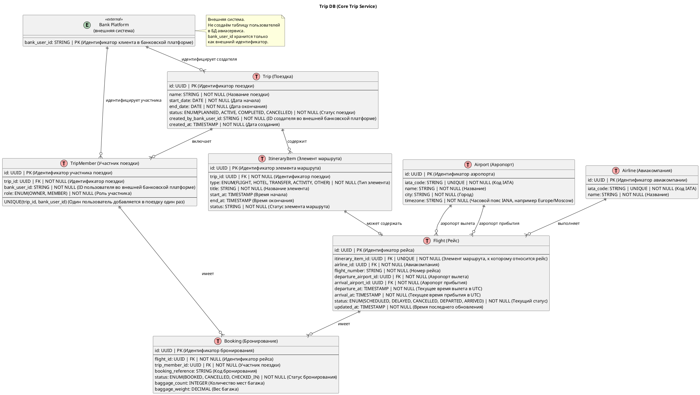
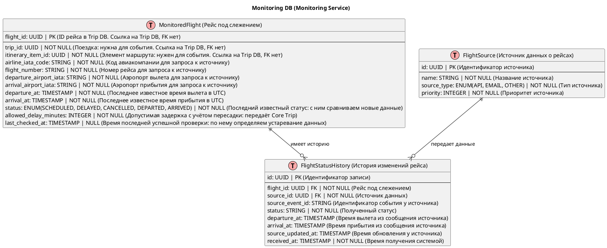
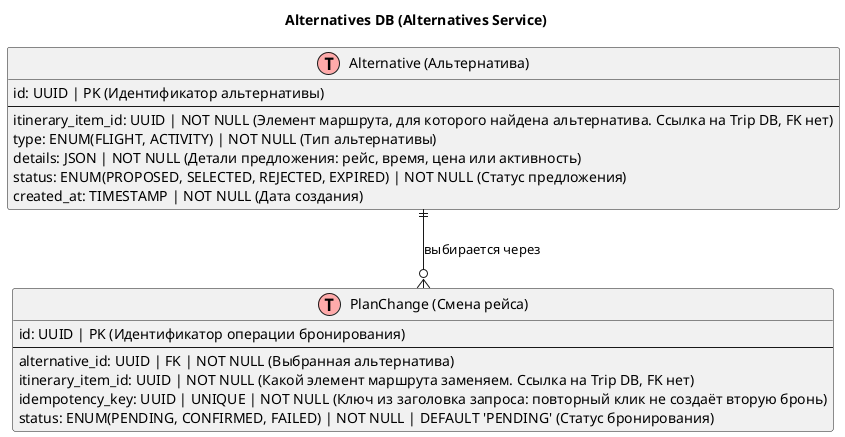
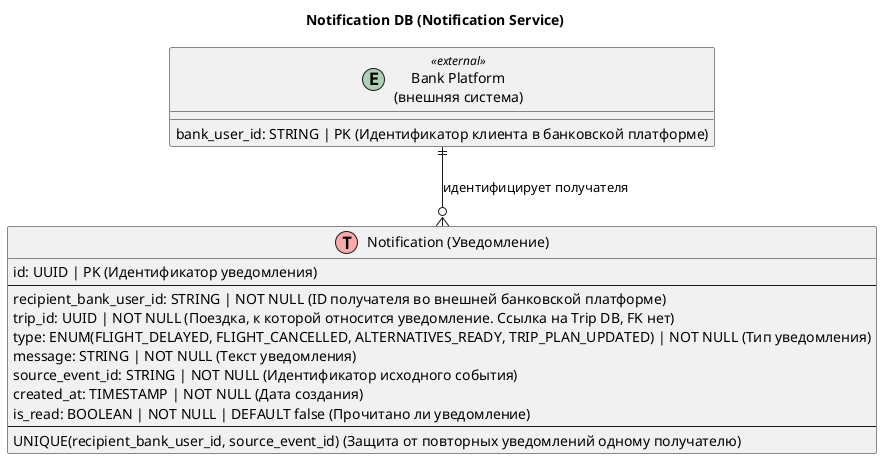

## 1. Таблицы БД

| БД | Сервис | Таблицы |
|---|---|---|
| Trip DB | Core Trip Service | `Trip`, `TripMember`, `ItineraryItem`, `Flight`, `Booking`, `Airport`, `Airline` |
| Monitoring DB | Monitoring Service | `FlightSource`, `FlightStatusHistory`, `MonitoredFlight` (новая) |
| Alternatives DB | Alternatives Service | `Alternative`, `PlanChange` (новая) |
| Notification DB | Notification Service | `Notification` |

## 2. Trip DB (Core Trip Service)

## 3. Monitoring DB (Monitoring Service)

## 4. Alternatives DB (Alternatives Service)

## 5. Notification DB (Notification Service)

